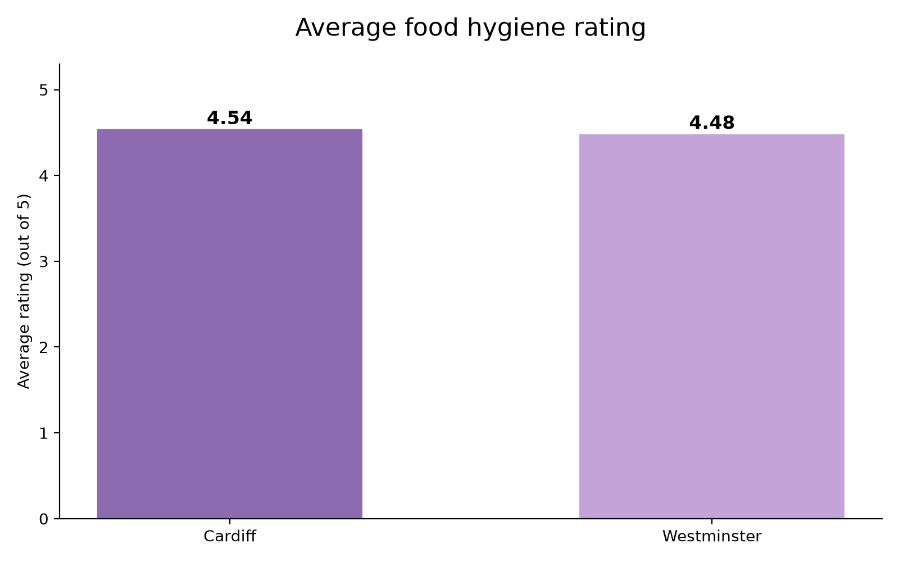
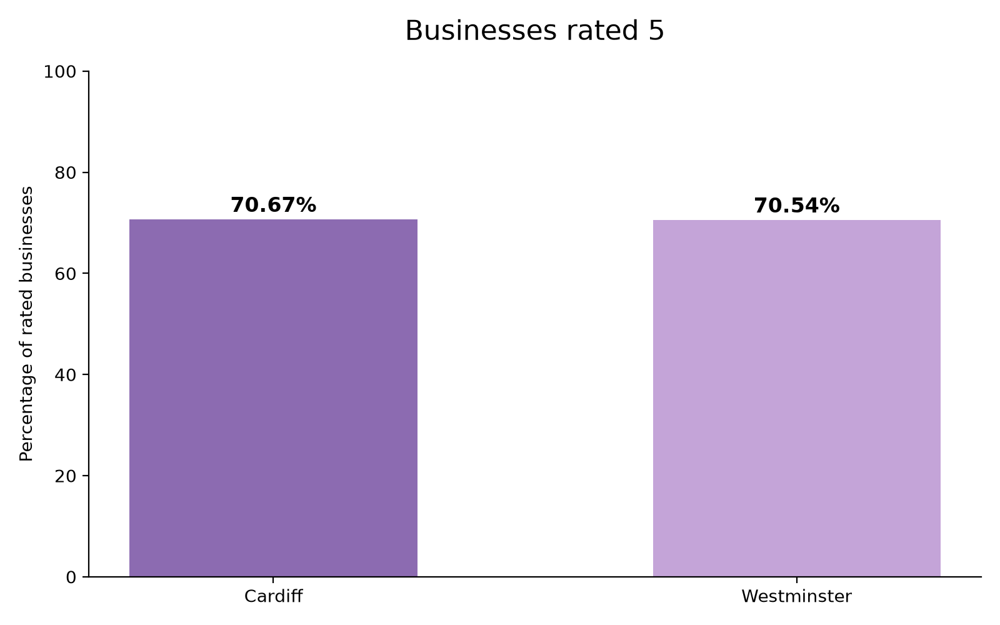
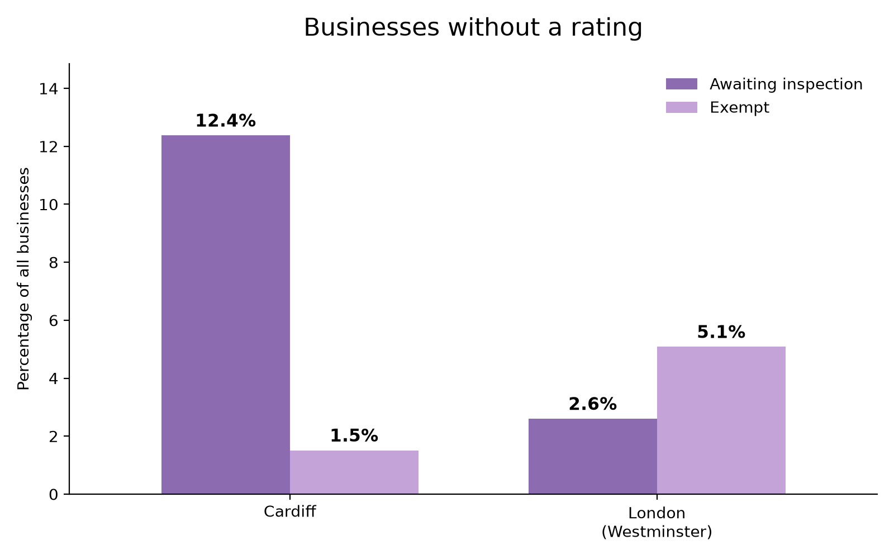
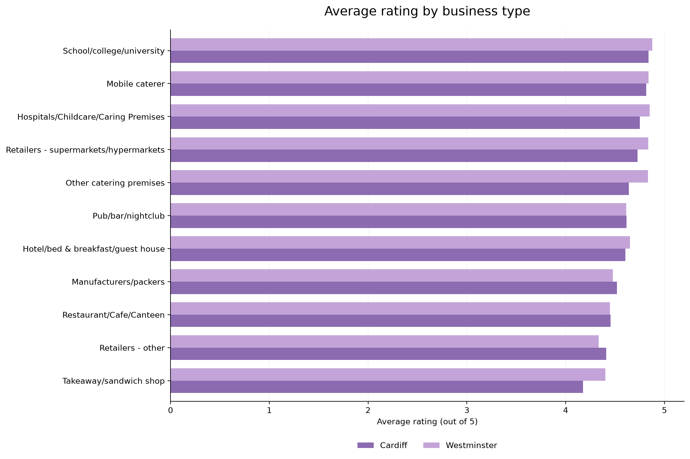

# Cardiff vs London: Food Hygiene Ratings Analysis

**Python | Pandas | SQL | SQLite | Matplotlib | SciPy**

## About This Project

For this project, I wanted to compare food hygiene ratings between Cardiff and London to see whether there were any noticeable differences between the two locations.

I used publicly available data from the Food Standards Agency (FSA), focusing on Cardiff and Westminster, one of London's boroughs.

Altogether, I analysed **9,268 food establishments**, with 3,506 from Cardiff and 5,762 from Westminster.

I used Python to clean and organise the data, SQL to analyse it and Matplotlib to create charts showing my findings. I also carried out statistical tests to see whether the differences I found were significant.

## Where I Got My Data

I downloaded both datasets directly from the Food Standards Agency (FSA), which publishes food hygiene ratings for businesses across the UK.

**Cardiff – Food Hygiene Ratings (XML)**

https://ratings.food.gov.uk/api/open-data-files/FHRS556en-GB.xml

**London (Westminster) – Food Hygiene Ratings (XML)**

https://ratings.food.gov.uk/api/open-data-files/FHRS533en-GB.xml

**Date collected:** 20 October 2026

The datasets included business names, business types, food hygiene ratings, rating dates and individual inspection scores.

Before starting the analysis, I used Python and Pandas to clean the data. This involved checking for duplicates, converting ratings into numeric values and organising the different rating statuses.

I also kept businesses without numeric ratings in the dataset because I wanted to compare inspection statuses separately.

## What I Wanted to Find Out

There were a few questions I wanted to answer:

- Which location had the highest average food hygiene rating?
- What percentage of businesses received a five-star rating?
- Did certain business types perform better in one location than the other?
- How many businesses were still awaiting inspection?
- Were the differences between Cardiff and Westminster statistically significant?

## My Findings

### 1. Average Food Hygiene Ratings



Cardiff had a slightly higher average food hygiene rating of **4.54 out of 5**, compared with **4.48 in Westminster**.

Although Cardiff came out higher, the difference was quite small.

### 2. Five-Star Ratings



I also looked at the percentage of businesses that received the highest possible food hygiene rating.

- **Cardiff:** 70.67%
- **Westminster:** 70.54%

Both locations had very similar results, with around 70% of their rated businesses receiving five stars.

### 3. Businesses Without a Numeric Rating



This was one of the more interesting parts of my analysis.

I found that Cardiff had **434 businesses awaiting inspection**, compared with **150 in Westminster**.

However, Westminster had more businesses exempt from receiving a rating, with 293 compared with 53 in Cardiff.

What stood out to me was that Cardiff had fewer businesses overall, yet a higher number awaiting inspection.

### 4. Ratings by Business Type



I wanted to look beyond the overall averages and see whether different types of businesses performed differently.

For example, takeaway and sandwich shops had an average rating of **4.17 in Cardiff**, compared with **4.40 in Westminster**.

This showed that even though the overall ratings were similar, there were differences when looking at individual business categories.

## Statistical Analysis

After comparing the ratings and creating the charts, I wanted to find out whether the differences were statistically significant.

I used SciPy to carry out three statistical tests, using a significance level of 0.05.

**1. Overall Rating Distributions (Mann–Whitney U Test)**

The p-value was **0.376**, meaning there wasn't enough statistical evidence to conclude that the rating distributions differed between Cardiff and Westminster.

**2. Five-Star Rating Proportions (Chi-Square Test)**

The p-value was **0.924**, showing no statistically significant difference in the proportion of businesses receiving five-star ratings.

**3. Businesses Awaiting Inspection (Chi-Square Test)**

The p-value was **less than 0.0001**, showing a statistically significant difference in the proportion of businesses awaiting inspection.

This was particularly interesting because the overall food hygiene ratings were very similar, but the inspection statuses showed a much clearer difference.

### Correlation Analysis

I also used Spearman's correlation to look at the relationship between overall food hygiene ratings and the three inspection component scores.

The results were:

- **Hygiene:** -0.56
- **Structural compliance:** -0.62
- **Confidence in management:** -0.69

All three showed negative correlations.

This makes sense because lower inspection component scores indicate better compliance, whereas a higher overall food hygiene rating indicates better performance.

Confidence in management had the strongest correlation with the overall rating out of the three components.

## How I Completed the Project

### 1. Collecting the Data

I downloaded the Cardiff and Westminster datasets from the Food Standards Agency in XML format.

### 2. Cleaning the Data

I used Python and Pandas to extract the information I needed, organise the columns, check for duplicates and deal with missing values.

I also converted ratings and inspection scores into numeric values so I could use them in my analysis.

### 3. Creating the Database

Once the data was cleaned, I saved it into a SQLite database.

This allowed me to use SQL to query the data rather than relying entirely on Python.

### 4. Analysing the Data with SQL

I wrote SQL queries to calculate average ratings, count establishments, compare rating distributions and look at differences between business types.

### 5. Statistical Testing

I used SciPy to carry out statistical tests and explore the relationships between overall ratings and inspection component scores.

### 6. Creating the Charts

Finally, I used Matplotlib to create four charts to make the findings easier to understand and compare.

## Tools I Used

- **Python:** Cleaning and analysing the data.
- **Pandas:** Working with and organising the datasets.
- **SQL:** Querying and comparing the data.
- **SQLite:** Storing the cleaned dataset.
- **Matplotlib:** Creating the charts.
- **SciPy:** Carrying out statistical tests.
- **VS Code:** Writing and running my code.

## Project Files

```text
charts/
    average_rating.png
    business_types.png
    five_star.png
    unrated_share.png

data/
    processed/
        food_hygiene_cleaned.csv

sql/
    analysis.sql

src/
    cleandata.py
    analysis.py
    charts.py

requirements.txt
README.md
```

The raw XML files and generated SQLite database are excluded from the GitHub repository.

## How to Run the Project

First, clone my GitHub repository:

```bash
git clone https://github.com/Rayanmohamed-1/Comparison-between-Cardiff-and-London-Food-Hygiene-.git
```

Open the project folder:

```bash
cd Comparison-between-Cardiff-and-London-Food-Hygiene-
```

Install the required Python libraries:

```bash
python3 -m pip install -r requirements.txt
```

Download the Cardiff and Westminster XML datasets using the FSA links above and save them as:

```text
data/raw/cardiff.xml
data/raw/westminster.xml
```

Then run the Python files in order:

```bash
python3 src/cleandata.py
python3 src/analysis.py
python3 src/charts.py
```

These scripts clean the data, create the SQLite database, run the analysis and generate the four charts.

## Limitations

There are a few things I had to consider when looking at my findings.

Firstly, I only used Westminster to represent London, so my results cannot be used to describe every London borough.

Secondly, the datasets represent a single point in time. Food hygiene ratings can change when businesses receive new inspections.

I also excluded businesses without numeric ratings from the average-rating calculations, although I included them when comparing inspection statuses.

Finally, differences in business types and rating dates may have influenced the results.

## What I Learned

This project gave me more experience working with real-world data and completing an analysis from start to finish.

I was able to collect and clean the data, create a database, write SQL queries, carry out statistical tests and present my findings using charts.

One thing I found particularly interesting was how similar the overall ratings were between Cardiff and Westminster, despite the noticeable difference in the number of businesses awaiting inspection.

It showed me why looking at averages alone doesn't always tell the full story.

I also became more confident using Python and SQL together rather than treating them as separate tools.

Overall, this project helped me improve my data cleaning, SQL, statistical analysis and data visualisation skills.
